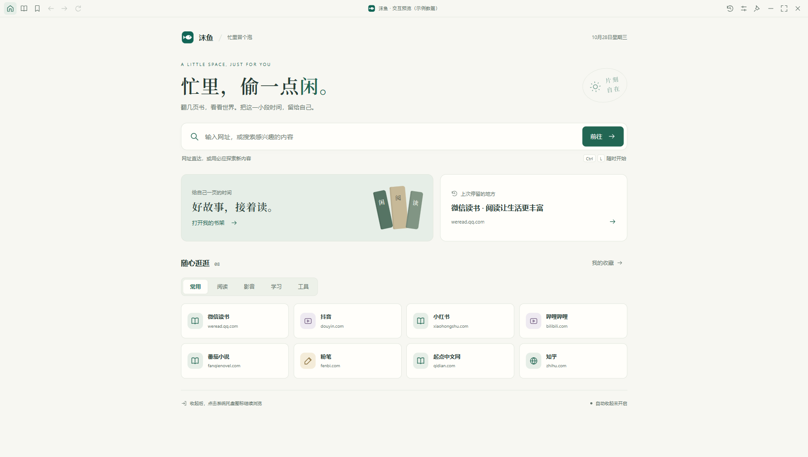
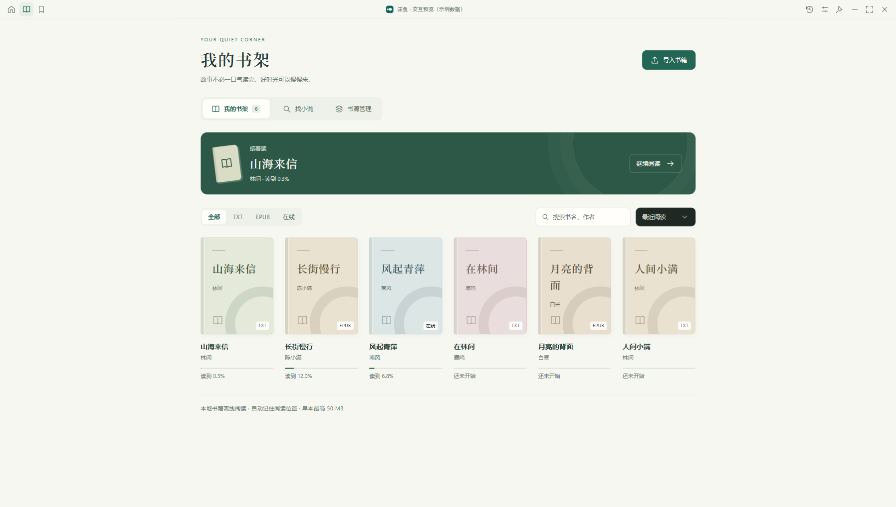
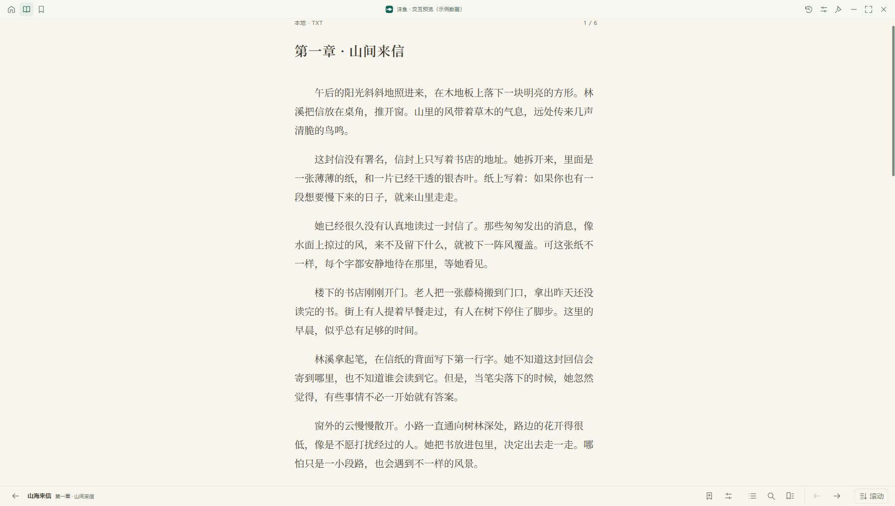
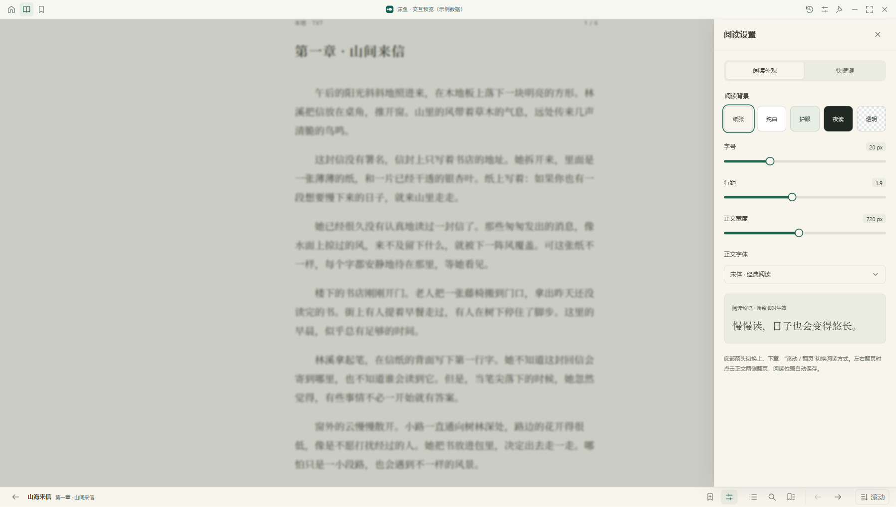
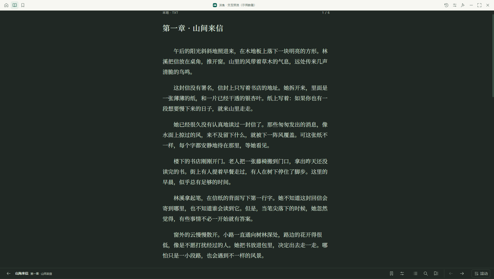
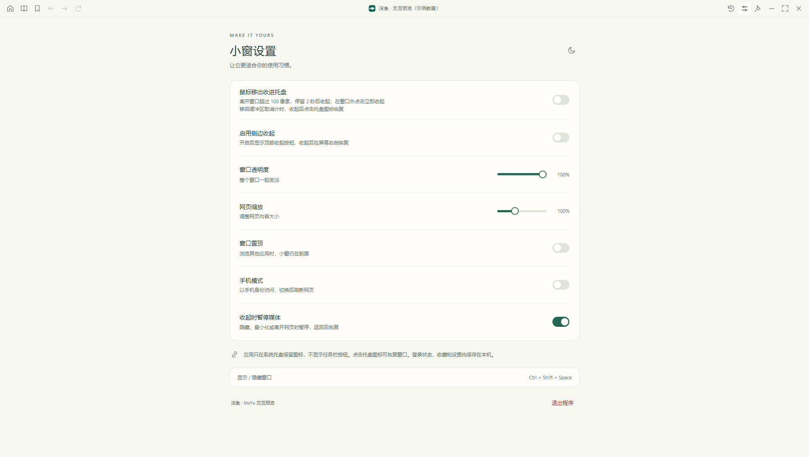
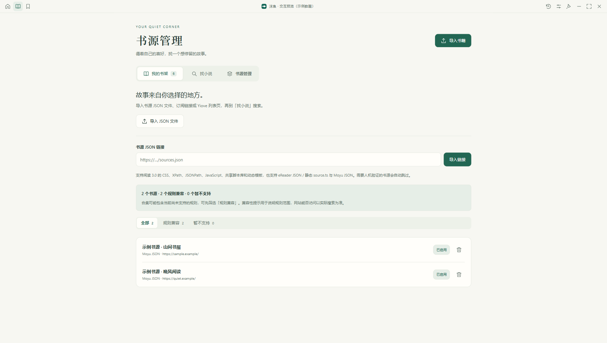

<div align="center">
  
  <h1>沫鱼 · MoYu</h1>
  <p><strong>忙里冒个泡。</strong></p>
  <p>把网页和故事装进一扇小窗，给自己留一点轻松的时间。</p>
  <p><a href="https://github.com/luabuCN/MoYu/releases">下载安装包</a> · <a href="#功能介绍">功能介绍</a> · <a href="#开发与运行">开发运行</a> · <a href="docs/RELEASING.md">自动发布说明</a></p>
  <p><a href="https://github.com/luabuCN/MoYu/actions/workflows/release.yml"></a>  </p>
</div>

沫鱼与“摸鱼”谐音，像一条吐着泡泡的小鱼。它是一款 **桌面小窗浏览器 + TXT / EPUB 阅读器**：可以打开常用网站、收藏网页、继续上次阅读，也可以用托盘、透明度和快捷键管理小窗。



## 界面一览

截图来自当前版本的交互预览，书籍、作者、书源和历史均为示例数据。预览页面不读取桌面版的个人资料。

| 我的书架 | 阅读正文 |
| --- | --- |
|  |  |
| **阅读设置** | **夜间阅读** |
|  |  |
| **小窗设置** | **书源管理** |
|  |  |

## 下载与安装

前往 [GitHub Releases](https://github.com/luabuCN/MoYu/releases) 选择对应平台。普通代码推送生成 **Pre-release 开发预览版**；`v*` 版本标签生成正式版，完整流程见 [发布说明](docs/RELEASING.md)。

| 平台 | 文件 | 安装方式 |
| --- | --- | --- |
| Windows x64 | `MoYu-版本-windows-x64-setup.exe` | 运行安装向导，选择安装位置，从桌面或开始菜单启动 |
| Mac / Apple Silicon | `MoYu-版本-macos-arm64.dmg` | 打开 DMG，将“沫鱼”拖入 Applications |
| Mac / Intel | `MoYu-版本-macos-x64.dmg` | 打开 DMG，将“沫鱼”拖入 Applications |

每个 Release 同时提供 `SHA256SUMS.txt` 校验文件和 `build-info.json` 提交信息。Windows 还支持从源码生成免安装版，整个发布文件夹一起携带即可。

没有配置发布者证书时生成的是开发预览包，系统可能提示无法验证发布者。Mac 正式分发需要 Developer ID 签名和 Apple 公证，配置方法见 [签名与公证](docs/RELEASING.md#签名与-mac-公证)。Mac 构建与实际兼容性以对应 Actions 运行和设备验证结果为准。

## 功能介绍

### 网页浏览

- **网址与搜索**：输入域名、完整网址或搜索词；普通搜索使用必应，支持中文域名和带端口的网址。
- **常用站点**：微信读书、抖音、小红书、B 站、番茄小说、起点等快捷入口，按常用、阅读、影音、学习和工具分类。
- **单窗口浏览**：链接、弹出页面、`target="_blank"`、`window.open()` 和验证页面统一在当前窗口打开；可后退、前进、刷新和返回首页。
- **继续浏览**：首页保留上次停留的网站；切换到阅读器或设置后，可恢复尚未关闭的网页。
- **关闭网页**：顶部按钮或 `Ctrl+W` 关闭当前页面、停止音视频并释放资源，保留历史、收藏、登录状态和阅读器页面。
- **收藏与历史**：收藏页面、从列表重新打开、移除收藏；保留最近 200 条历史，清空历史前可取消确认。
- **独立登录资料**：Cookie 和网站存储保存在沫鱼自己的配置中。外部 Chrome / Edge 的登录状态不会自动导入。
- **访问体验**：网页缩放 50%–200%、手机访问模式、细圆角滚动条；网页全屏限制在应用窗口内，`F11` 切换、`Esc` 返回。

### 本地书架与阅读

- **导入 TXT / EPUB**：支持多选，单本最高 50 MB；书籍复制到资料目录，原文件移动后仍可阅读；重复导入保留原有进度。
- **编码与章节识别**：TXT 支持 UTF-8、UTF-16、GB18030 / GBK，识别中文章回和英文 Chapter；没有标题时按内容分段。
- **EPUB 排版**：支持书内目录、图片、封面、章节导航和 CFI 阅读位置。
- **书架管理**：按 TXT、EPUB、在线格式筛选，搜索书名与作者，按最近阅读或书名排序；“接着读”继续最近一本书，移除书籍前确认。
- **自动保存进度**：记录各书阅读位置，重开、调整窗口、修改字体或切换模式时保留阅读位置。
- **两种阅读方式**：上下滚动，或左右分页；分页模式点击正文左右两侧翻页，底部箭头切换上、下章。
- **目录、搜索、书签**：搜索章节目录、查找正文、添加或取消当前位置书签、从书签返回。在线书籍的正文搜索覆盖已缓存章节。
- **阅读外观**：字号、行距、正文宽度、正文字体和纸张 / 纯白 / 护眼 / 夜读背景即时调整。
- **透明阅读**：隐藏上下工具栏，使用透明窗口和黑色正文；快捷键切换，`Esc` 或托盘入口恢复普通界面。效果受操作系统窗口合成影响。
- **自定义快捷键**：修改翻页、换章、滚动和透明切换键，检测重复和保留组合键；可调整按键滚动速度与是否启用滚动键。

### 在线小说与书源

- **书源管理**：导入本地 JSON、订阅链接、静态 `source.ts` 或 Yiove 书源列表页，启用、停用与移除书源。
- **搜索与入库**：从启用的书源搜索书名、作者，将结果加入书架；搜索过程中可停止请求。
- **换源续读**：切换前确认目录和正文能够读取，再尝试对应当前章节继续阅读。
- **规则兼容**：支持常用阅读 3.0 规则、eReader JSON / 静态 `source.ts` 和 MoYu JSON，涵盖 CSS、XPath、JSONPath、正则替换、动态模板及 GBK 搜索。
- **JavaScript 规则**：QuickJS 沙箱支持脚本、共享 `jsLib` 和常用 `java` 网络 / 编码 / Cookie 接口；脚本与 Node.js、系统文件访问隔离。
- **验证与错误处理**：需人机验证的书源自动跳过，显示超时、网络或规则错误；请求支持取消、响应大小与执行时间限制。
- **示例书源**：`examples/中华典藏书源.json` 可导入古典小说与名著书源。站点改版可能影响规则，完整格式和能力边界见 [READER.md](READER.md)。

### 小窗、托盘与媒体

- **窗口管理**：拖动、边缘缩放、置顶、最小化、最大化；整个窗口透明度 30%–100%，界面深浅主题切换。
- **托盘恢复**：关闭按钮收起窗口；点击托盘恢复，或用 `Ctrl+Shift+Space` 显示 / 隐藏。从设置或托盘菜单可彻底退出。
- **移出自动收起**：默认关闭。鼠标离开窗口超过 100 像素并停留 2 秒后收进托盘；回到缓冲区取消计时，移回原位置不会自动重开。
- **外部点击收起**：Windows 上支持点击应用区域外立即收起，依赖 Windows 原生组件；macOS 当前不包含外部点击监听。鼠标移出检测使用窗口坐标检测。
- **防止意外收起**：恢复窗口、拖动、缩放、菜单和文件选择期间抑制自动收起，重新进入窗口后恢复检测。
- **侧边恢复条**：可选启用，手动收起后在屏幕右侧显示恢复入口；鼠标移出触发的收起仍进入托盘。
- **收起时暂停媒体**：默认开启。隐藏、最小化或切到首页等面板时静音并暂停音视频，覆盖跨域 iframe、开放 Shadow DOM 与 Web Audio；返回网页后恢复先前播放状态，手动暂停的内容继续暂停。

### 界面与当前范围

暖白纸感与青绿色界面，自适应窄窗口布局；自定义下拉框、滑块、抽屉和滚动区域支持键盘操作、焦点恢复、夜读和减少动画偏好。书籍、进度、收藏与设置保存在本地。

目前采用单窗口浏览模式，尚未提供第三方插件市场、云同步或应用内自动更新。EPUB 的 DRM 内容不在支持范围内；网站登录、风控、会员和版权限制遵循站点本身要求。

## 常用快捷键

| 操作 | 默认快捷键 |
| --- | --- |
| 显示 / 隐藏小窗 | `Ctrl+Shift+Space`，Mac 为 `⌘+Shift+Space` |
| 返回首页输入网址 | `Ctrl+L` / `⌘+L` |
| 收藏网页 / 打开历史 | `Ctrl+D` / `Ctrl+H`，Mac 可用 `⌘` |
| 关闭网页 | `Ctrl+W` / `⌘+W` |
| 刷新 / 窗口内全屏 | `F5` / `F11` |
| 后退 / 前进 | `Alt+←` / `Alt+→` |
| 阅读上一页 / 下一页 | `←` / `→` |
| 阅读上一章 / 下一章 | `Ctrl+←` / `Ctrl+→` |
| 阅读向上 / 向下滚动 | `↑` / `↓` |
| 切换透明阅读 | `Ctrl+Shift+T` |
| 打开阅读设置 | `Ctrl+,` |
| 恢复普通阅读 / 退出窗口内全屏 | `Esc` |

阅读快捷键可在“阅读设置 → 快捷键”修改，Mac 可自行使用 `Meta`（⌘）组合键。全局快捷键被占用时会提示，可使用托盘恢复。

## 资料保存与迁移

| 运行方式 | 数据目录 |
| --- | --- |
| 源码运行 | 项目根目录 `data/browser/` |
| Windows 免安装版 | EXE 同目录 `data/browser/` |
| Windows 安装版 | `%APPDATA%/MoYu/data/browser/` |
| macOS 安装版 | `~/Library/Application Support/MoYu/data/browser/` |

`settings.json` 保存窗口设置、收藏和历史，`profile/` 保存浏览器配置与登录资料，`reader/` 保存书籍副本、书源、阅读设置和进度。

同一种运行方式升级后继续使用原资料目录。切换源码版、免安装版或安装版时，先从托盘彻底退出，再将原来 `data/browser/` 的内容复制到目标资料目录；不要覆盖运行中的配置。登录凭据可能受系统与账号加密保护，跨设备或系统后可能需要重新登录。卸载安装版默认保留用户资料。

## 开发与运行

技术栈为 **Vue 3 + Vite + Electron**，组件交互使用 Reka UI。需要 Node.js **22.12+**；CI 使用 Node.js 24。Windows 外部点击组件由系统 .NET Framework C# 编译器构建，Mac 构建跳过该组件。

```sh
git clone https://github.com/luabuCN/MoYu.git moyu
cd moyu
npm ci
npm run dev
```

Windows 也可运行 `install_browser.bat` 安装依赖并构建，之后双击 `start_moyu.bat`。开发服务器仅监听本机 `127.0.0.1`。

| 命令 | 用途 |
| --- | --- |
| `npm run dev` | Vue 热更新 + Electron 桌面调试 |
| `npm run dev:preview` | 浏览器界面预览：`http://127.0.0.1:5186/?preview` |
| `npm run build` | 生成图标、原生组件、第三方声明与界面产物 |
| `npm run preview` / `npm start` | 启动已构建界面 / 构建后启动 |
| `npm test` | 核心、规则、资料路径和发布逻辑测试 |
| `npm run test:integration` | 使用临时配置的 Electron 集成检查 |
| `npm run dist:win` | Windows NSIS 安装包，输出 `release/` |
| `npm run dist:mac` | 在 Mac 生成 arm64 / x64 DMG，输出 `release/` |
| `npm run package` | Windows 免安装目录，输出 `dist/沫鱼-win32-x64/` |
| `npm run package:update` | 更新免安装版，备份旧程序并保留资料 |
| `npm run submit -- "提交说明"` | 创建 Git 提交并推送，触发 GitHub 构建发布 |

交互预览使用内存示例书籍，不执行真实导入、网站浏览和系统窗口控制，刷新后恢复。预览模块只在 Vite 开发环境的 `?preview` 模式加载，不进入正式构建。

## 自动构建与 Releases

每次 `git push` 后，[Actions](https://github.com/luabuCN/MoYu/actions) 自动测试，分别在 Windows、Apple Silicon Mac、Intel Mac 上构建。三个任务全部成功后上传至 [Releases](https://github.com/luabuCN/MoYu/releases)。仅在本机 `git commit` 不触发构建，一次推送只构建最后一个提交。

```sh
npm run submit -- "feat: 本次功能说明"
```

正式版本通过 `npm version patch` 更新版本并创建标签，再执行 `git push origin main --follow-tags`。首次 Git 配置、签名密钥、失败重跑和发布规则见 [docs/RELEASING.md](docs/RELEASING.md)。

## 项目结构

```text
moyu/
├── .github/workflows/release.yml   自动构建与发布
├── src/                           Vue 界面、阅读排版与规则解析
├── main.cjs                       窗口、网页、托盘与 IPC
├── app-paths.cjs                  三种发行方式的资料路径
├── reader.cjs                     书架、导入与网络请求
├── legado-*.cjs / legado-runtime.js 书源脚本沙箱
├── native/                        Windows 外部点击监听源码
├── assets/brand/                  品牌图标
├── examples/                      示例书源
├── docs/                          截图与发布说明
├── scripts/                       开发、打包、提交与发布脚本
├── test/                          单元与集成检查
├── electron-builder.config.cjs    Windows / Mac 安装包配置
└── READER.md                      书源格式与阅读器说明
```

## 依赖与许可

本仓库沿用 GitHub 仓库初始化时选择的 [Apache-2.0 许可证](LICENSE)。旧 Python 项目的许可证文本保留在 [licenses/SHPEERLAZY-LICENSE.txt](licenses/SHPEERLAZY-LICENSE.txt)。

界面和阅读功能使用 Vue、Reka UI、epub.js、JSZip、DOMPurify、QuickJS 等开源依赖，各自许可见 [THIRD-PARTY-NOTICES.txt](THIRD-PARTY-NOTICES.txt)。书源引擎与兼容宿主独立实现，eReader 仅作为格式参考；网页内容和书籍版权归各自权利人所有。
